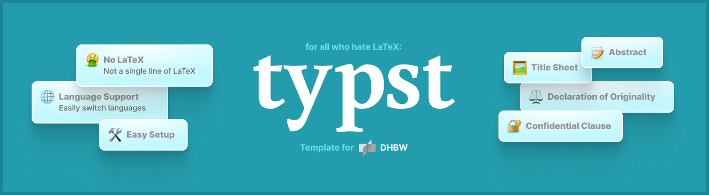

# DHBW Typst

We build and maintain [Typst](https://typst.app/) templates for academic writing at DHBW and beyond. Our goal is to make writing reports, project papers and theses easier, so you can focus on your content rather than your typesetting setup.

Our main project is **ODERSO**, short for **Organized Documentation for Experimental Research and Scientific Outputs**. Originally created by students at SAP in 2023, the template supports DHBW Karlsruhe, DHBW Mannheim and IHK.

## Why Typst?

Typst combines readable syntax, fast compilation and useful error messages with the tools needed for scientific writing. It supports citations and bibliographies, and you can work locally with Visual Studio Code and Tinymist or use the Typst web editor.

If your document contains confidential company information, check whether you are allowed to use an online editor before uploading it.

## Start writing

Use the [ODERSO template](https://github.com/dhbw-typst/oderso-template) to create your own document. Its README walks you through the setup and explains how to preview and export your work.

You can also find [ODERSO on Typst Universe](https://typst.app/universe/package/dhbw-oderso/).

Before getting started, explore the [DHBW Karlsruhe preview](https://github.com/dhbw-typst/oderso-template/releases/latest/download/main-dhbw-ka.pdf), [DHBW Mannheim preview](https://github.com/dhbw-typst/oderso-template/releases/latest/download/main-dhbw-ma.pdf) or [IHK preview](https://github.com/dhbw-typst/oderso-template/releases/latest/download/main-ihk.pdf). The [package documentation](https://github.com/dhbw-typst/oderso-template/releases/latest/download/documentation.pdf) describes the available functions and configuration options.

## Our repositories

### [ODERSO template](https://github.com/dhbw-typst/oderso-template)

The starting point for users. Create a repository from the template and follow the included examples to write your own report or thesis.

### [ODERSO development](https://github.com/dhbw-typst/oderso-template-dev)

The home of the template source, package documentation and development tooling. This is where we work on features, fix bugs and discuss improvements.

### [ODERSO template and tools](https://github.com/dhbw-typst/oderso-template-and-tools)

Example document sources for DHBW Karlsruhe, DHBW Mannheim and IHK, including chapters on formatting, reference management and citations, as well as a glossary and appendix.

### [Typst Universe packages](https://github.com/dhbw-typst/typst-universe-packages)

Our fork of the official Typst package repository, used for contributions to Typst Universe.

## Get involved

The template grows through contributions from its users. Bug reports, documentation improvements, new features and adapters for additional institutions are welcome.

Visit the [development repository](https://github.com/dhbw-typst/oderso-template-dev), [open an issue](https://github.com/dhbw-typst/oderso-template-dev/issues/new) or read the [contribution guide](https://github.com/dhbw-typst/oderso-template-dev/blob/main/CONTRIBUTING.md). If you would like a first task, browse the [issues for new contributors](https://github.com/dhbw-typst/oderso-template-dev/contribute).
